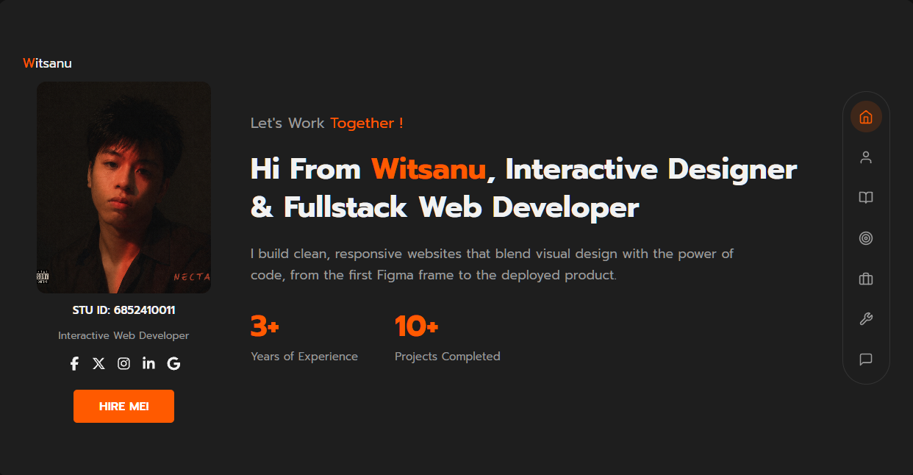

# 🚀 Witsanu's Interactive Portfolio | React + TypeScript + Vite

*Personal portfolio website showcasing interactive design and fullstack web development projects.*


<br />

<div align="center">
  
  <br />
  <p><strong>🔗 Live Demo:</strong> <a href="[https://your-vercel-link.vercel.app](https://vercel.com/aom-vscode/~/deployments)">witsanu-portfolio.vercel.app</a> (Deployed via Vercel)</p>
</div>

---

## ✨ Key Features

- **Modern Interactive UI/UX:** ออกแบบหน้าเว็บธีม Dark & Orange ที่โดดเด่น ทันสมัย พร้อมแถบนำทางด้านข้าง (Sidebar Navigation)
- **Fast Performance with Vite:** พัฒนาด้วย React + TypeScript บน Vite Bundler ทำให้โหลดหน้าเว็บได้อย่างรวดเร็ว
- **Fully Responsive Layout:** รองรับการแสดงผลอย่างสมบูรณ์แบบทั้งบนหน้าจอ Desktop, Tablet และ Mobile

## 📂 Project Structure

```text
├── public/              # Static assets (images, icons, preview.png)
├── src/                 # Application source code
│   ├── assets/          # Project assets (images, fonts)
│   ├── components/      # Reusable UI components
│   ├── App.tsx          # Main Application component
│   └── main.tsx         # Application entry point
├── .gitignore           # Ignored files for Git
├── index.html           # HTML entry point
├── package.json         # Project dependencies & scripts
├── tsconfig.json        # TypeScript configuration
├── vercel.json          # Vercel deployment configuration
└── vite.config.ts       # Vite bundler configuration
